<h1 align="center">Widget Lab</h1>

<p align="center">
A collection of 22 polished, interactive widgets — wallet, currency exchange, timer, recorder, system monitor and more — built with React, TypeScript, Tailwind, Motion, GSAP and D3.<br>
Every widget uses an approved aspect ratio, morphs its panels inline, and only loads when you open it.
</p>

<p align="center">
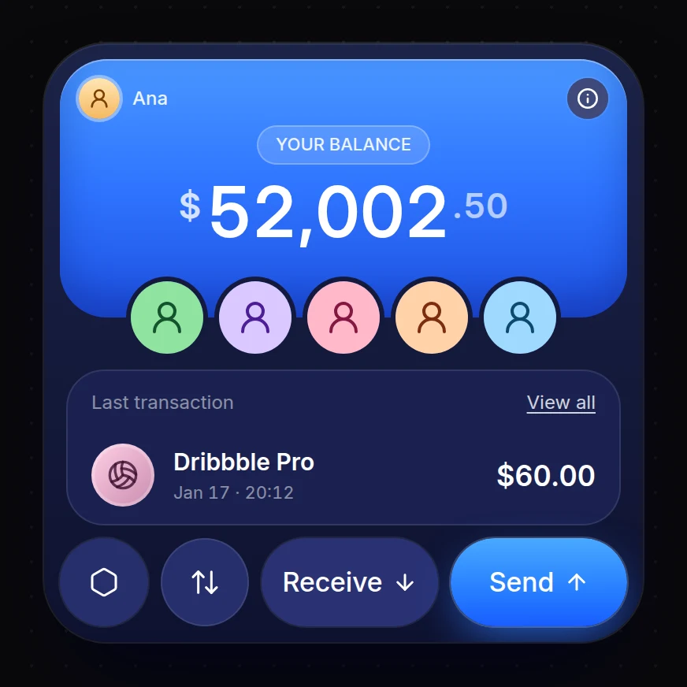
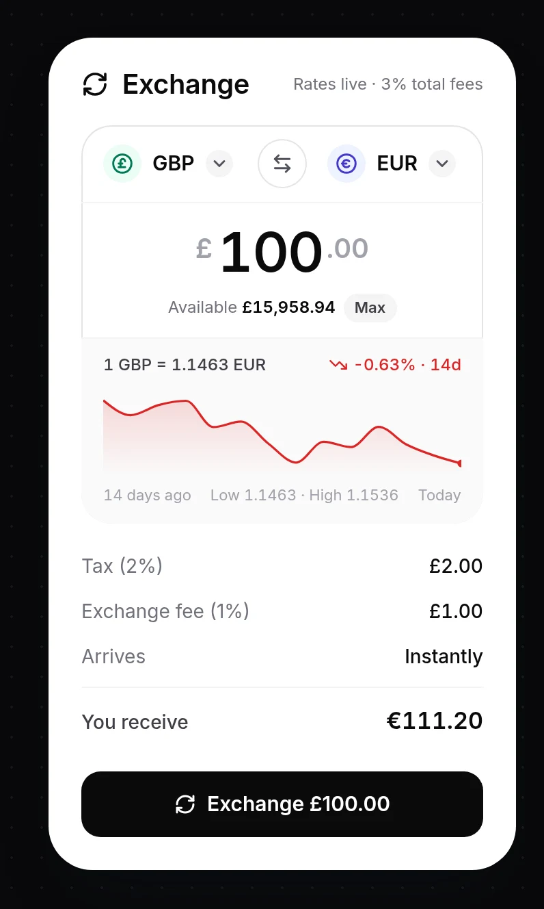
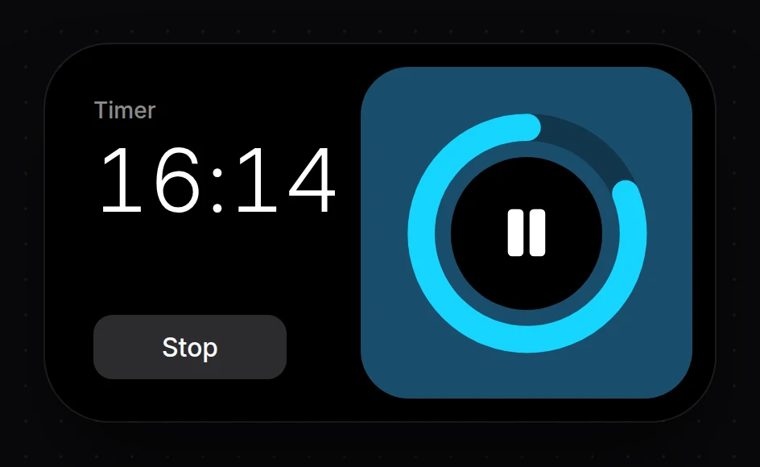
</p>

## Highlights

- **Real interactions, not mockups** — send money with validation, exchange currencies with live balances, record and divide takes, keep the machine awake, edit photos.
- **Inline morphing** — buttons grow into their panels in place (no dialogs, sheets or popovers), with a fixed-size content wrapper so nothing reflows mid-animation.
- **Motion from easings.net** — every curve comes from [`src/lib/motion.ts`](src/lib/motion.ts); springs stay critically damped; reduced-motion is respected everywhere.
- **Lightweight browsing** — a shadcn-style index lists the widgets; only the one you open is loaded and running (each widget is its own lazy chunk).
- **Premium type** — Inter with optical sizing, tabular figures, and digit-level number morphing.
- **Built-in quality gates** — a static rule checker and a frame-by-frame motion audit in headless Chrome.

## Gallery

### Finance

<table>
<tr>
<td align="center" valign="top" width="50%">
<a href="src/components/widgets/wallet/WalletWidget.tsx"></a><br>
<sub><b>Wallet</b> · Balance, contacts and send/receive flows with an inline transaction history.</sub>
</td>
<td align="center" valign="top" width="50%">
<a href="src/components/widgets/currency-exchange/CurrencyExchangeWidget.tsx"></a><br>
<sub><b>Currency Exchange</b> · Convert between currencies with live fees and a swap action.</sub>
</td>
</tr>
<tr>
<td align="center" valign="top" width="50%">
<a href="src/components/widgets/my-cards/MyCardsWidget.tsx">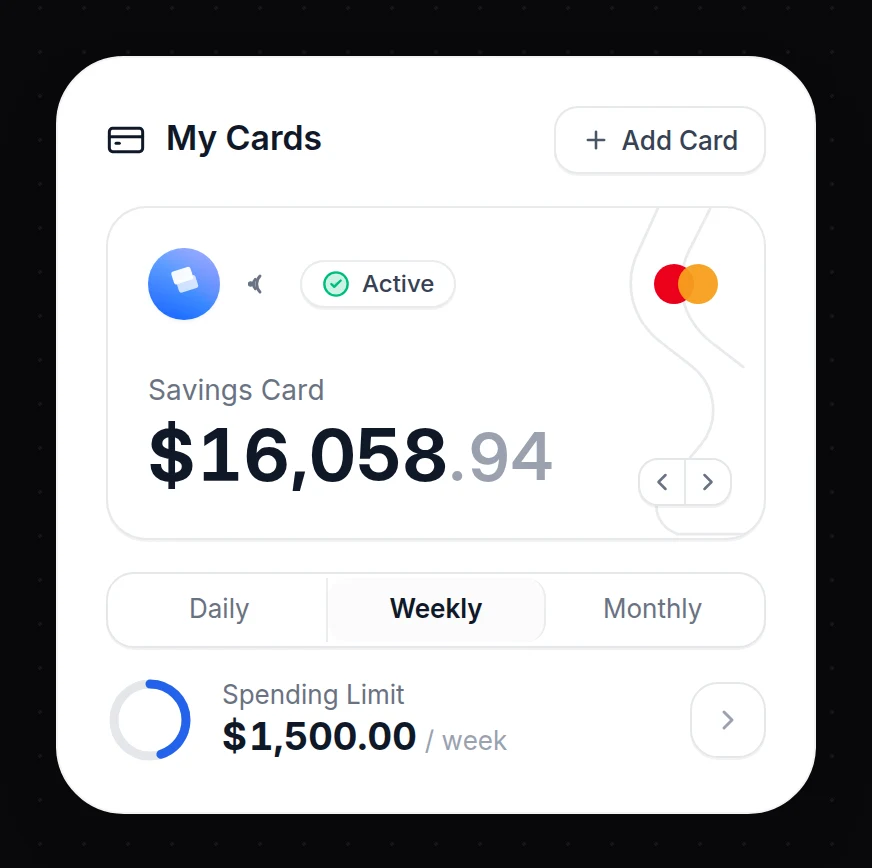</a><br>
<sub><b>My Cards</b> · Swipeable payment cards with spending limits by period.</sub>
</td>
<td align="center" valign="top" width="50%">
<a href="src/components/widgets/growth/GrowthWidget.tsx">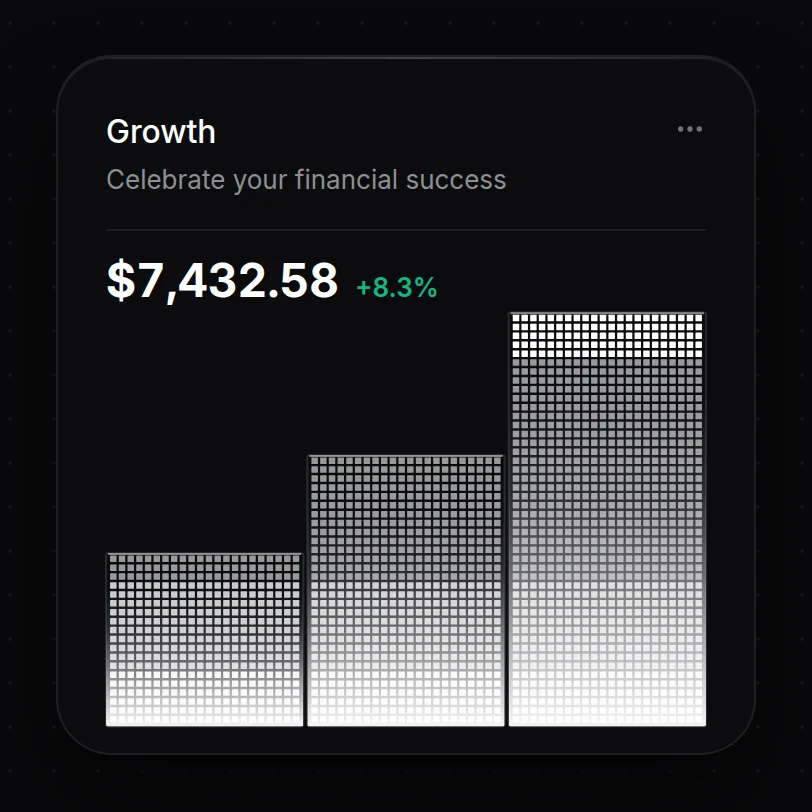</a><br>
<sub><b>Growth</b> · Dot-matrix bar chart of portfolio growth across 1M / 6M / 1Y.</sub>
</td>
</tr>
<tr>
<td align="center" valign="top" width="50%">
<a href="src/components/widgets/stacks-card/StacksCardWidget.tsx">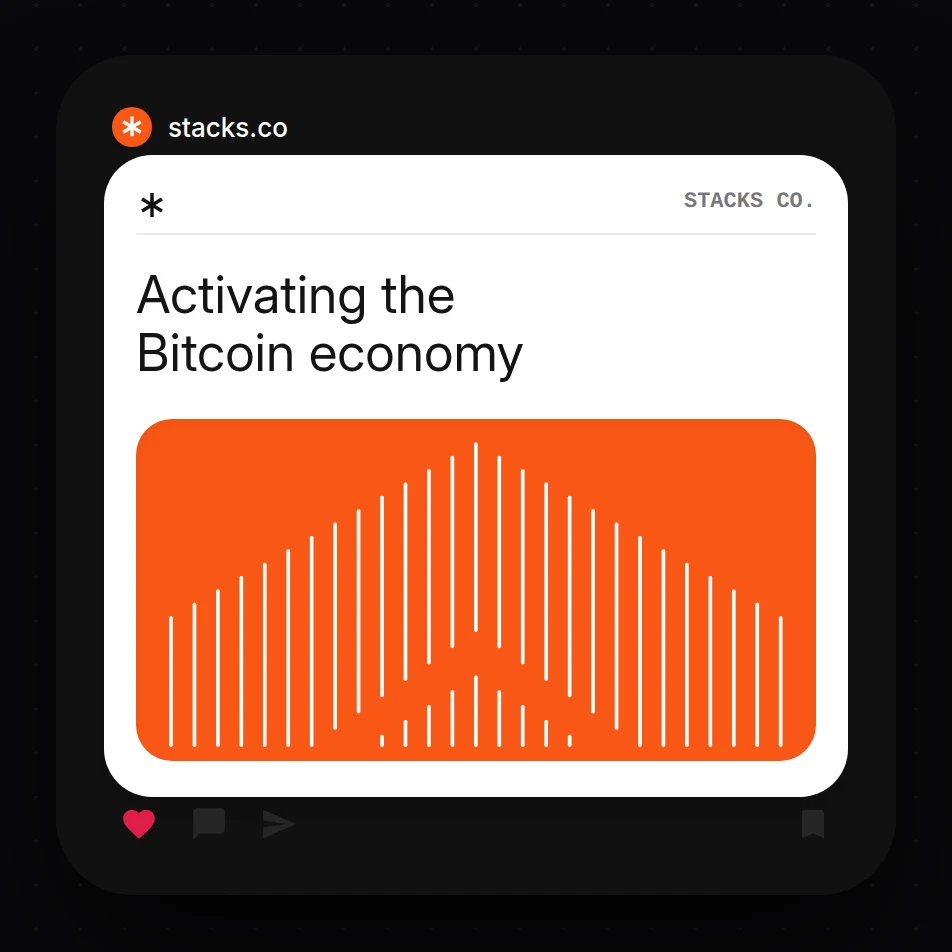</a><br>
<sub><b>Stacks</b> · Editorial card for the Bitcoin economy with an expanding graphic.</sub>
</td>
<td width="50%"></td>
</tr>
</table>

### Health & Fitness

<table>
<tr>
<td align="center" valign="top" width="50%">
<a href="src/components/widgets/heart-rate/HeartRateWidget.tsx">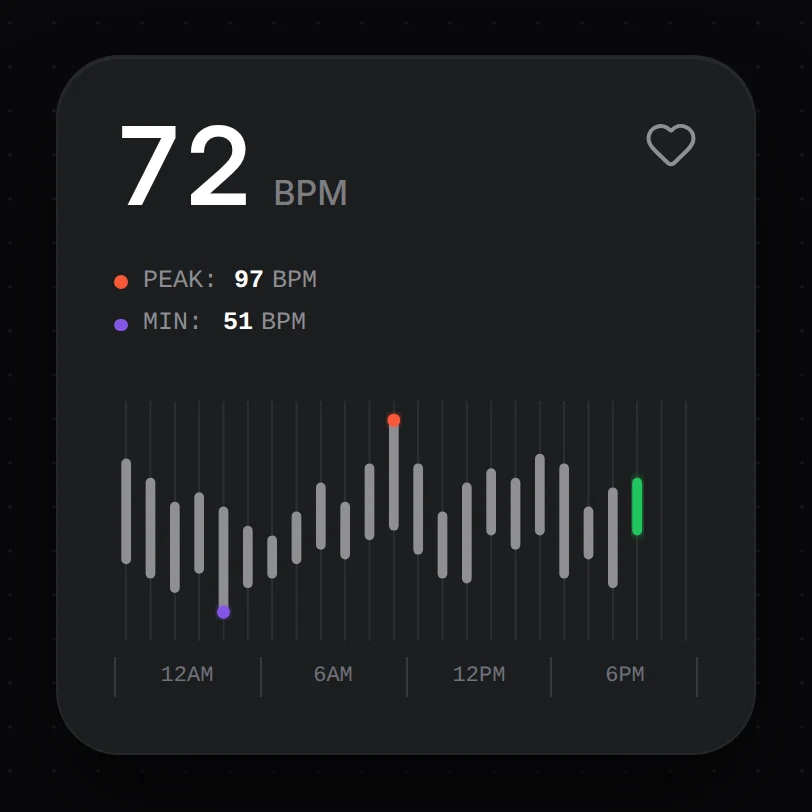</a><br>
<sub><b>Heart Rate</b> · BPM with peak/min markers and a daily range chart.</sub>
</td>
<td align="center" valign="top" width="50%">
<a href="src/components/widgets/pai-rings/PaiRingsWidget.tsx">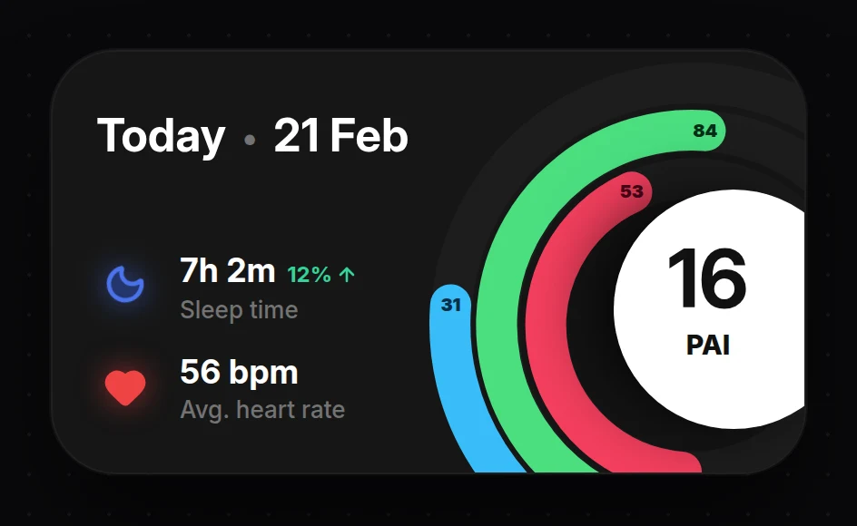</a><br>
<sub><b>PAI Rings</b> · Activity rings with sleep, strength and VO₂ max.</sub>
</td>
</tr>
<tr>
<td align="center" valign="top" width="50%">
<a href="src/components/widgets/athletic-score/AthleticScoreWidget.tsx">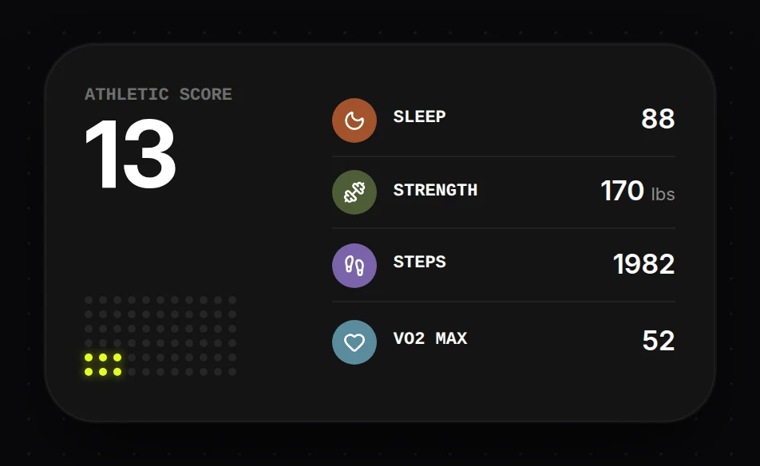</a><br>
<sub><b>Athletic Score</b> · Training readiness score with recovery telemetry.</sub>
</td>
<td width="50%"></td>
</tr>
</table>

### Productivity

<table>
<tr>
<td align="center" valign="top" width="50%">
<a href="src/components/widgets/standby-timer/StandbyTimerWidget.tsx"></a><br>
<sub><b>StandBy Timer</b> · Countdown with a progress ring, presets and pause / resume.</sub>
</td>
<td align="center" valign="top" width="50%">
<a href="src/components/widgets/system-monitor/SystemMonitorWidget.tsx">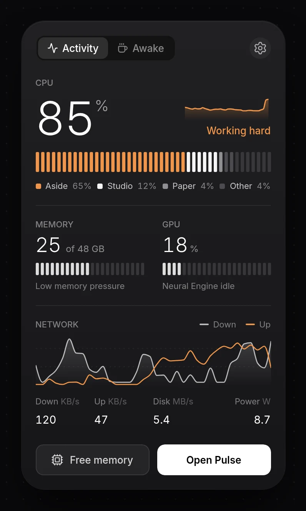</a><br>
<sub><b>System Monitor</b> · D3 CPU sparkline, memory/GPU meters, network chart and keep-awake.</sub>
</td>
</tr>
<tr>
<td align="center" valign="top" width="50%">
<a href="src/components/widgets/recorder/RecorderWidget.tsx">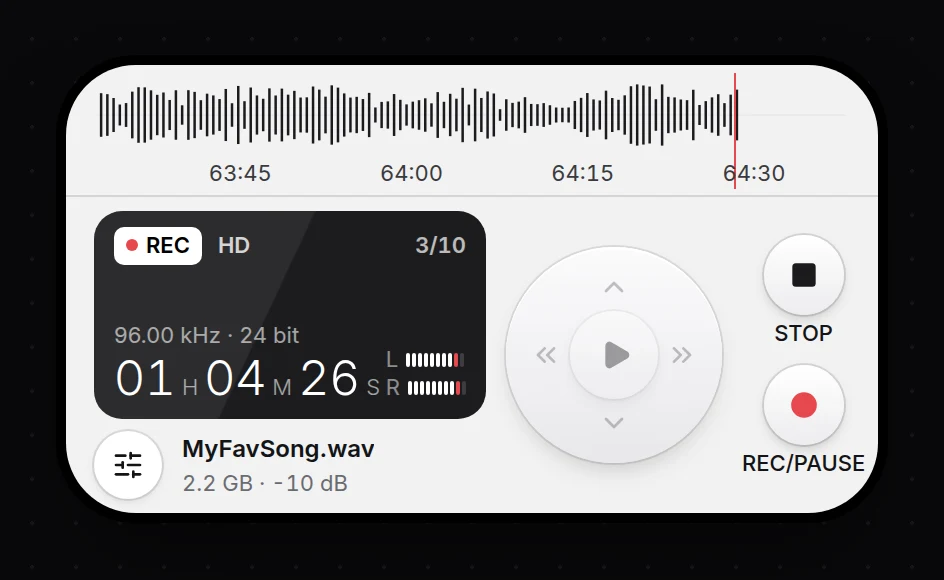</a><br>
<sub><b>Recorder</b> · Field recorder with waveform timeline, takes, seek and options.</sub>
</td>
<td align="center" valign="top" width="50%">
<a href="src/components/widgets/scans-mail/ScansMailWidget.tsx"></a><br>
<sub><b>Scans Mail</b> · Envelope that opens into a swipeable viewer of 36 scans.</sub>
</td>
</tr>
</table>

### Media

<table>
<tr>
<td align="center" valign="top" width="50%">
<a href="src/components/widgets/story-carousel/StoryCarouselWidget.tsx">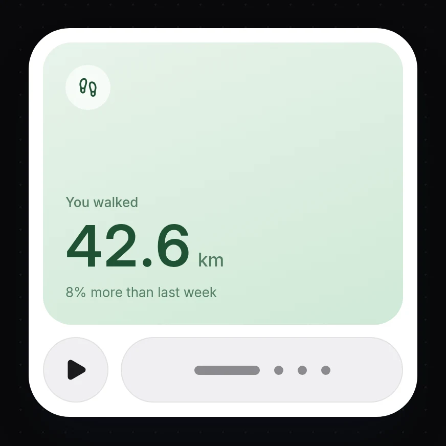</a><br>
<sub><b>Story Carousel</b> · Auto-advancing weekly recap with play / pause / replay pagination.</sub>
</td>
<td align="center" valign="top" width="50%">
<a href="src/components/widgets/photo-card/PhotoCardWidget.tsx">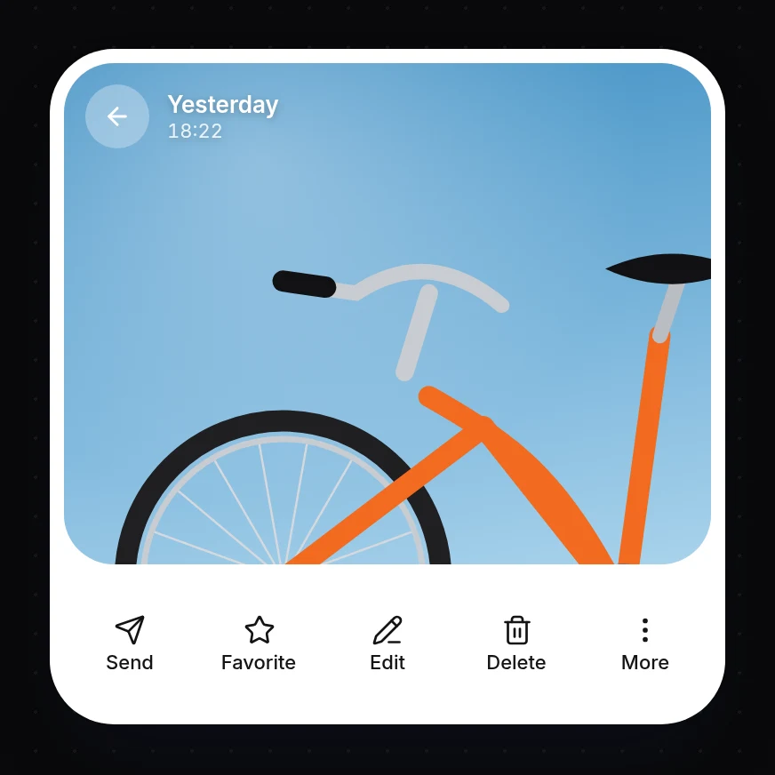</a><br>
<sub><b>Photo Card</b> · Photo viewer with album grid, edit sliders, favourite, share and delete.</sub>
</td>
</tr>
</table>

### Profiles

<table>
<tr>
<td align="center" valign="top" width="50%">
<a href="src/components/widgets/mini-portfolio/MiniPortfolioWidget.tsx">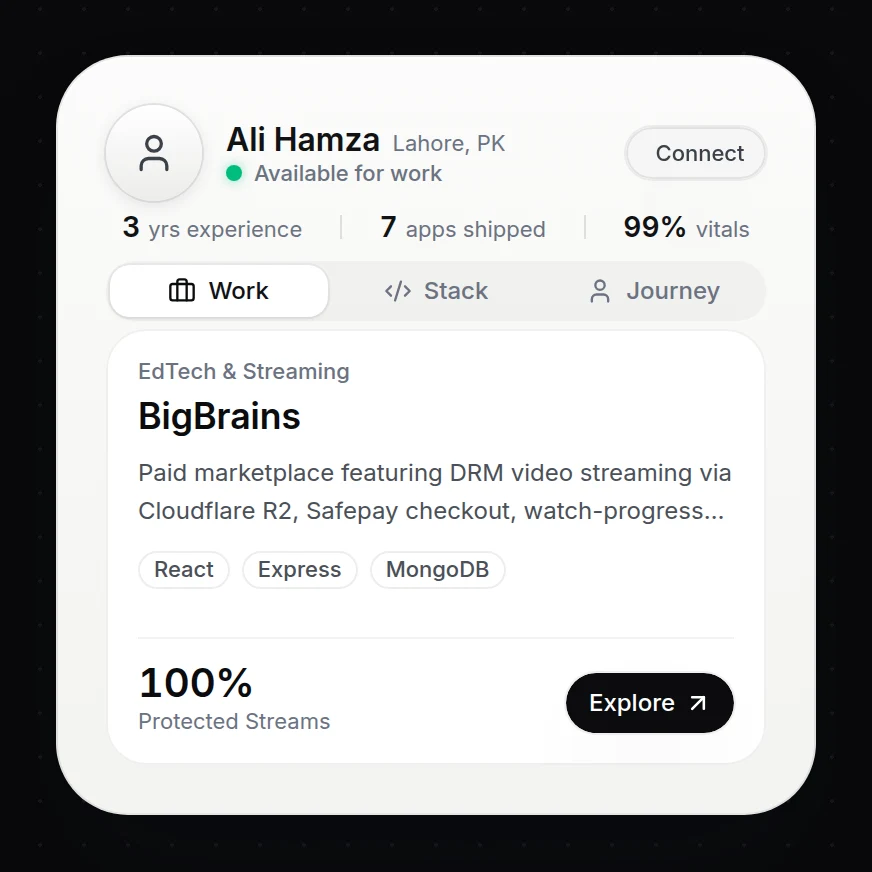</a><br>
<sub><b>Mini Portfolio</b> · Developer profile with work carousel, stack and journey tabs.</sub>
</td>
<td align="center" valign="top" width="50%">
<a href="src/components/widgets/designer-profile/DesignerProfileWidget.tsx">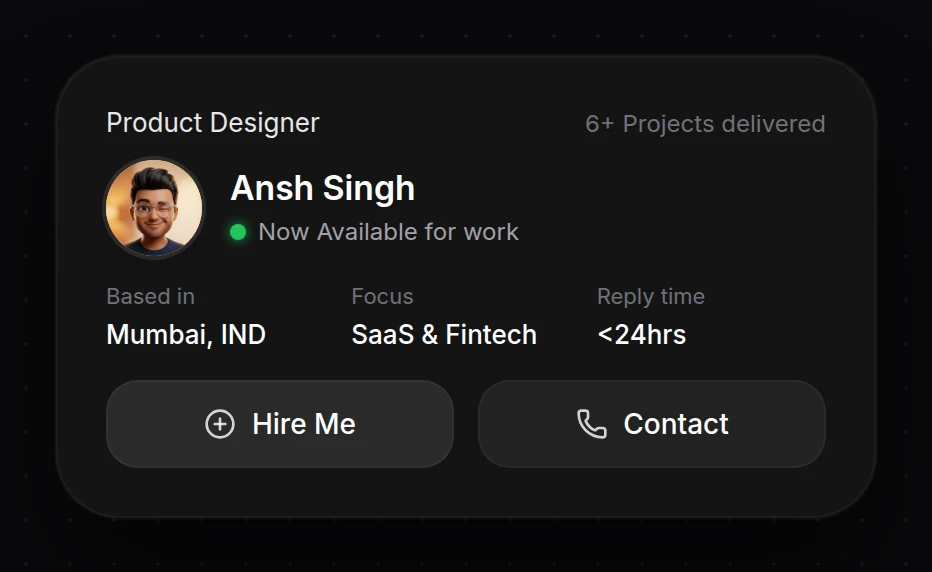</a><br>
<sub><b>Designer Profile</b> · Product designer card with availability and quick actions.</sub>
</td>
</tr>
<tr>
<td align="center" valign="top" width="50%">
<a href="src/components/widgets/birthday-card/BirthdayCardWidget.tsx">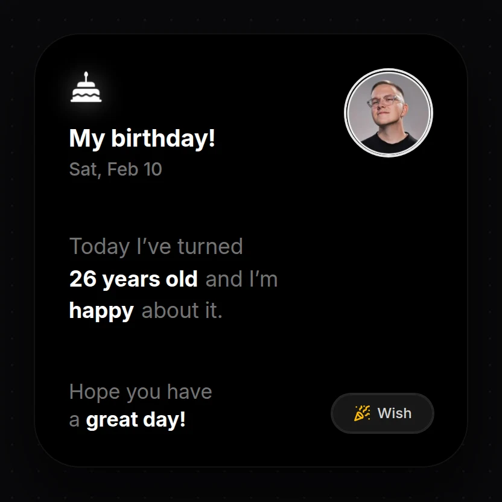</a><br>
<sub><b>Birthday Card</b> · Celebration card with a candle to blow out and quick wishes.</sub>
</td>
<td width="50%"></td>
</tr>
</table>

### Jobs

<table>
<tr>
<td align="center" valign="top" width="50%">
<a href="src/components/widgets/job-post/JobPostWidget.tsx">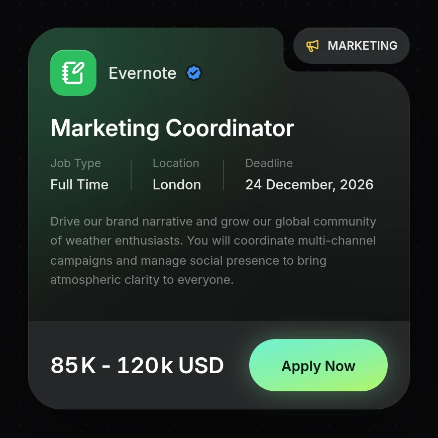</a><br>
<sub><b>Job Post</b> · Marketing role with a deadline calendar and inline application.</sub>
</td>
<td align="center" valign="top" width="50%">
<a href="src/components/widgets/variant-job/VariantJobWidget.tsx">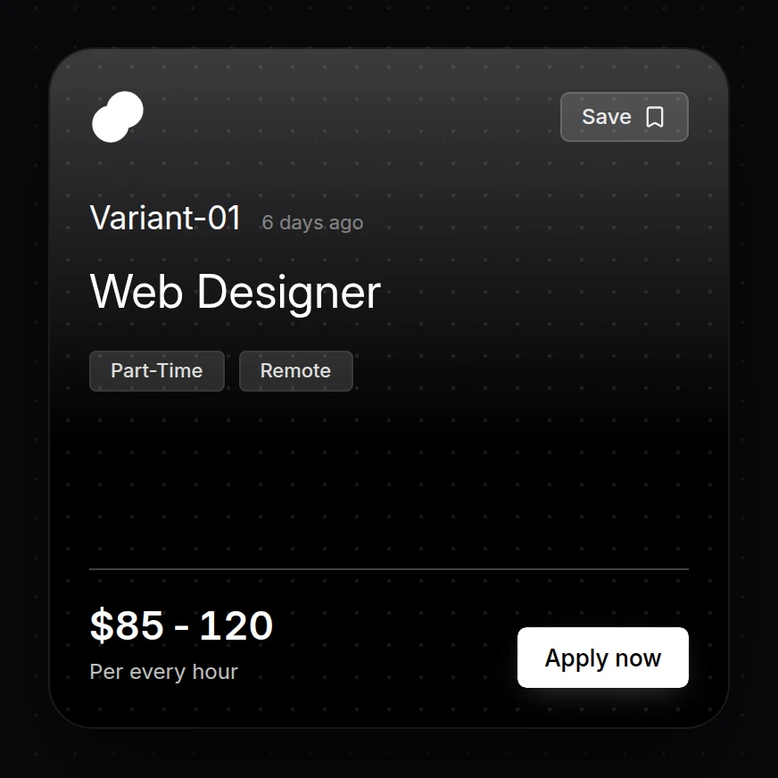</a><br>
<sub><b>Web Designer Job</b> · Dark job card with save, hourly/monthly pay and apply flow.</sub>
</td>
</tr>
</table>

### Commerce & Mobility

<table>
<tr>
<td align="center" valign="top" width="50%">
<a href="src/components/widgets/banana-item/BananaItemWidget.tsx">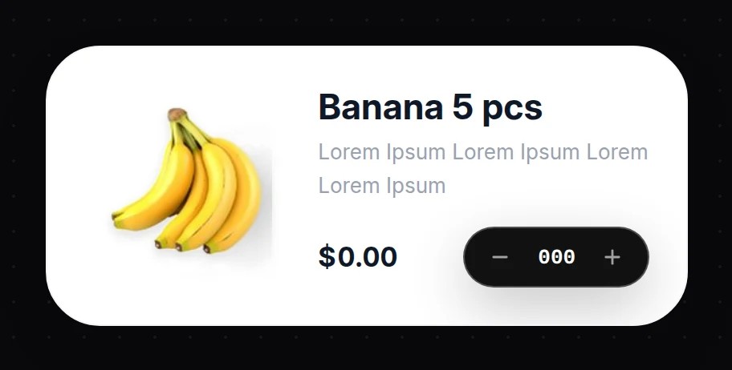</a><br>
<sub><b>Grocery Item</b> · Product row with a quantity stepper that opens bulk options.</sub>
</td>
<td align="center" valign="top" width="50%">
<a href="src/components/widgets/upgrade-pro/UpgradeProWidget.tsx">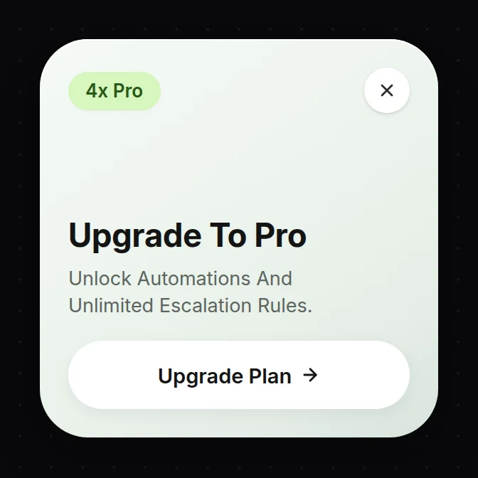</a><br>
<sub><b>Upgrade to Pro</b> · Upsell card with activate and dismiss / undo.</sub>
</td>
</tr>
<tr>
<td align="center" valign="top" width="50%">
<a href="src/components/widgets/bike-tracker/BikeTrackerWidget.tsx">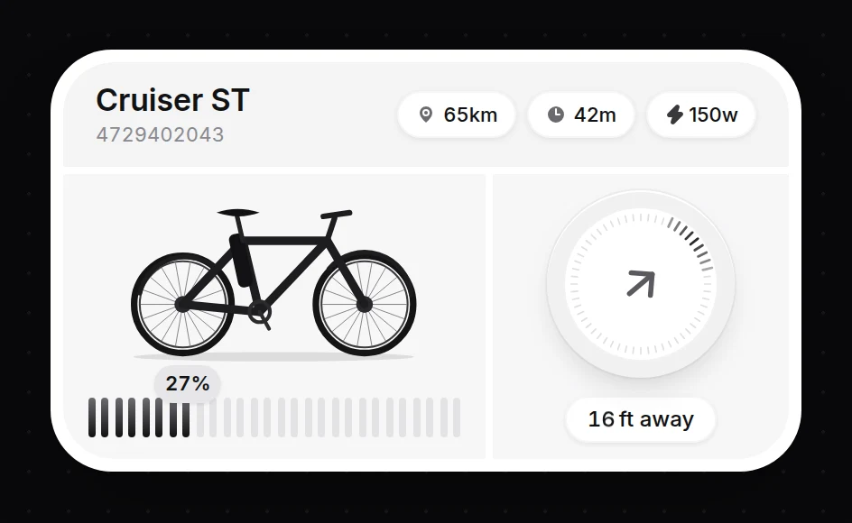</a><br>
<sub><b>E-Bike Tracker</b> · Battery range, trip stats and a finder compass that rings the bike.</sub>
</td>
<td width="50%"></td>
</tr>
</table>

## Getting started

```bash
npm install
npm run dev
```

Open <http://localhost:5173>, pick a widget from the list, or go straight to one with its hash, e.g. <http://localhost:5173/#/wallet>.

| Command | What it does |
|---|---|
| `npm run dev` | Start the dev server |
| `npm run build` | Type-check and build for production |
| `npm run lint` | Lint the project |

## Project structure

```
src/
  shell/                  # app shell: sidebar, index page, widget page, hash routing
    registry.ts           # every widget: name, category, description, lazy import
  components/
    widgets/<name>/       # one folder per widget
    custom/               # MorphContainer, NumberMorph, TextMorph, FitToWidth
  lib/motion.ts           # easings.net curves, durations, springs
  hooks/use-lenis.ts      # smooth page scrolling
.agents/skills/widget-generation/
  SKILL.md                # design + interaction rules for building widgets
  references/             # easing guide, lessons learned
  scripts/                # check-widget.mjs, motion-audit.mjs
docs/screenshots/         # the images in this README
```

## Quality checks

```bash
# static rules: easings, springs, morph containers, icons, text sizes, overlays
node .agents/skills/widget-generation/scripts/check-widget.mjs src/components/widgets/wallet

# frame-by-frame morph audit in headless Chrome (dev server running)
node .agents/skills/widget-generation/scripts/motion-audit.mjs --url "http://localhost:5173/#/wallet" --widget "YOUR BALANCE" --morph "Send" --reduced
```

## Tech stack

React 19 · TypeScript · Vite · Tailwind CSS 4 · Motion · GSAP · D3 · Embla Carousel · Lenis · Lucide icons · Inter
